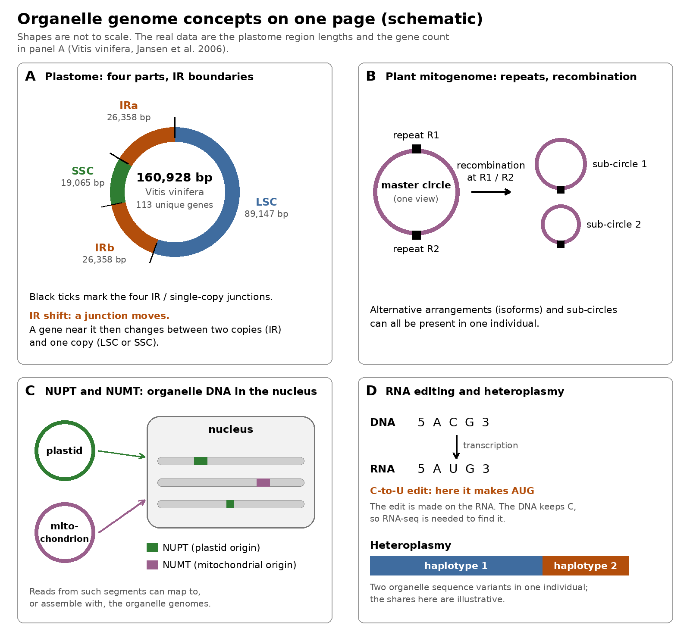

# grapevine-plastid

English | [中文](README.zh.md)

## Start here

This repository is a knowledge base on plant plastid (chloroplast) and mitochondrial genomes: how they are built, how to assemble, annotate and draw them, and how to deal with nuclear copies (NUPT and NUMT), RNA editing and heteroplasmy. It explains the ideas, lists the tools for each analysis step with their papers or repositories, and gives one reference route. Grapevine (*Vitis*) is the worked example throughout. The chapters, the catalogue and the shell wrappers below are reference material, not a maintained software package.

| I want to | Go to |
|---|---|
| learn the main ideas | [Knowledge map: concepts](docs/KNOWLEDGE_MAP.md#concepts) |
| choose a tool for one step | [Knowledge map: tools by analysis step](docs/KNOWLEDGE_MAP.md#tools-by-analysis-step) |
| follow one route from reads to a checked genome | [Knowledge map: reference workflow](docs/KNOWLEDGE_MAP.md#reference-workflow) |
| see the published grapevine organelle genomes | [Knowledge map: grapevine organelle genomes](docs/KNOWLEDGE_MAP.md#grapevine-organelle-genomes); [chapter 8](docs/08_vitis.md) |
| read one topic in depth | [Contents](#contents) below |
| look at the guide figures | [`docs/figures/guide/`](docs/figures/guide/README.md) |
| reuse text, figures or code | [`LICENSE`](LICENSE) (code, MIT) and [`NOTICE.md`](NOTICE.md) (text and figures, CC BY 4.0) |

The chapters and the catalogue follow below.

A methods notebook for **plant chloroplast (plastid) and mitochondrial genomes**, with a grapevine (*Vitis*) focus. The repository name says "plastid", but mitochondria are in scope from the first page: assembly, annotation, graph structure, NUMT/NUPT traffic, RNA editing, inheritance, and organelle pangenomes / population data. This is a public teaching collection. It does not contain private lab assemblies or unpublished results.

Every factual statement below and in the chapter files is supposed to come from a paper or a GitHub repository that was actually opened (reading dates are in `SOURCES_READ.tsv`: 15 and 27 November 2026, CST). Each chapter ends with a **claim–source table**: the claim, the DOI or URL, a quoted sentence or a figure/table label, and whether the abstract or the full text was read. Claims we could not source are omitted or marked [待确认]. The reading log is `SOURCES_READ.tsv`.

## Contents

| Chapter | File (English / Chinese) | Built from |
|---|---|---|
| 1. What these genomes are | [docs/01_overview.md](docs/01_overview.md) / [docs/01_overview.zh.md](docs/01_overview.zh.md) | Jansen 2006 (full text); Gualberto & Newton 2017 (abstract); Sloan et al. 2012 (full text); Kozik et al. 2019 (full text); Wu et al. 2022 (abstract); Christensen 2014 (full text); JIPB 2025 grape sizes (full text) |
| 2. Assembly tools | [docs/02_assembly.md](docs/02_assembly.md) / [docs/02_assembly.zh.md](docs/02_assembly.zh.md) | GetOrganelle, NOVOPlasty, Freudenthal comparison, PMAT, Oatk, HiMT, PMAT2, MitoHiFi, long-read plastid assembly — papers plus their GitHub READMEs |
| 3. Graphs and alternative conformations | [docs/03_graphs_conformations.md](docs/03_graphs_conformations.md) / [docs/03_graphs_conformations.zh.md](docs/03_graphs_conformations.zh.md) | GetOrganelle; Kozik 2019; Fischer et al. 2022; GSAT (abstract only); Oatk; Bandage; JIPB Fig. S1 |
| 4. Annotation and maps | [docs/04_annotation_visualization.md](docs/04_annotation_visualization.md) / [docs/04_annotation_visualization.zh.md](docs/04_annotation_visualization.zh.md) | GeSeq, CPGAVAS2, PGA, OGDRAW, Chloroplot, IRscope (abstract), ODNA |
| 5. NUMTs and NUPTs | [docs/05_numt_nupt.md](docs/05_numt_nupt.md) / [docs/05_numt_nupt.zh.md](docs/05_numt_nupt.zh.md) | NUPT review 2026; JIPB 2025; Oatk DNA-exchange result |
| 6. Heteroplasmy and RNA editing | [docs/06_heteroplasmy_rna_editing.md](docs/06_heteroplasmy_rna_editing.md) / [docs/06_heteroplasmy_rna_editing.zh.md](docs/06_heteroplasmy_rna_editing.zh.md) | NOVOPlasty; PREP-Mt; PREPACT 1 (abstract), 2.0 and 3.0 (full text); Gualberto & Newton 2017; Oatk |
| 7. Inheritance and cytonuclear interaction | [docs/07_inheritance_cytonuclear.md](docs/07_inheritance_cytonuclear.md) / [docs/07_inheritance_cytonuclear.zh.md](docs/07_inheritance_cytonuclear.zh.md) | Birky 2001 (abstract); JXB 2026 review (full text); JIPB 2025 |
| 8. Grapevine organelle work | [docs/08_vitis.md](docs/08_vitis.md) / [docs/08_vitis.zh.md](docs/08_vitis.zh.md) | Jansen 2006; Arroyo-García et al. 2006 (abstract); Zecca et al. 2012 (abstract); Tabidze et al. 2014 (abstract); PLOS ONE 2018; JIPB 2025; IJMS 2026 (409 cultivars) |
| 9. Organelle pangenomes and population data | [docs/09_pangenome_popgen.md](docs/09_pangenome_popgen.md) / [docs/09_pangenome_popgen.zh.md](docs/09_pangenome_popgen.zh.md) | JIPB Grapepan_mt / Grapepan_cp; IJMS 2026; Arroyo-García 2006; Tabidze 2014 |

Figures are original SVG drawings (not journal reprints): [figures/](figures/), made by [scripts/figures/draw_organelle_schematics.py](scripts/figures/draw_organelle_schematics.py).

## Software wrappers

The shell wrappers in [scripts/wrappers/](scripts/wrappers/) only print commands taken from tool READMEs or papers. They support `--dry-run` and `--help`. **They have not been run against real reads on this machine.** Binaries such as GetOrganelle, PMAT, Oatk, NOVOPlasty and HiMT were not executed here.

## What we are not claiming

- The JIPB 2025 main text says plastid genomes of 33 *Vitis* accessions had “TEs accounted for about 87% (Tables S4, S5)”. That sentence is real. The supplementary tables are not in the PMC XML, but they are in the Europe PMC supplementary file (read 27 November 2026, CST): Averaged over the 33 plastomes, Table S5 gives about 84% for interspersed repeats only (0.839–0.845 per plastome) and about 88% with all repeat classes (small RNA, satellites, simple repeats and low-complexity regions added; 0.883–0.887 per plastome). The main text says about 87%, and the paper does not say which measure it used. Even so, 87% TE in a 159–164 kb, four-part plastome is hard to reconcile with the typical unrearranged *Vitis* plastome described by Jansen et al. 2006. Treat the 87% figure as this paper’s repeat-annotation result, not as a general fact about plastids.
- No grape-specific substitution rate for LTR or organelle dating is given here.
- This folder does not copy any private grape-mitochondria project files.

## Catalogue

[catalog/CATALOG.tsv](catalog/CATALOG.tsv) lists only the sources that were read and cited in a chapter. `SOURCES_READ.tsv` is the longer log of everything that was opened, including off-topic hits from title search that were **not** used in the teaching text.

## This is not

* Not nuclear PAV or graph work: [vitis-pangenome](https://github.com/Xuzhen-Li/vitis-pangenome)
* Not theory dossiers or classic-paper folders: [genomics-theory-mining](https://github.com/Xuzhen-Li/genomics-theory-mining)
* Not aDNA damage or authentication: [grapevine-adna](https://github.com/Xuzhen-Li/grapevine-adna)
* Not the modern 167K product: [grapeancestry](https://github.com/Xuzhen-Li/grapeancestry)

## What will land later

Methods, scripts, and notes only.

- Plastid assembly notes
- Plastid pangenome and phylogeny recipes
- Public-data pointers when a release exists

No unpublished genotypes, private coordinates, or sample-level matrices.

## See also

- [vitis-pangenome](https://github.com/Xuzhen-Li/vitis-pangenome) - nuclear graphs, PAV, mixed-variant / dosage
- [grapevine-adna](https://github.com/Xuzhen-Li/grapevine-adna) - damage, authentication, aDNA capture
- [genomics-theory-mining](https://github.com/Xuzhen-Li/genomics-theory-mining) - one classic paper, one folder

**Author:** Xuzhen Li - [ORCID](https://orcid.org/0000-0003-3670-6657)
