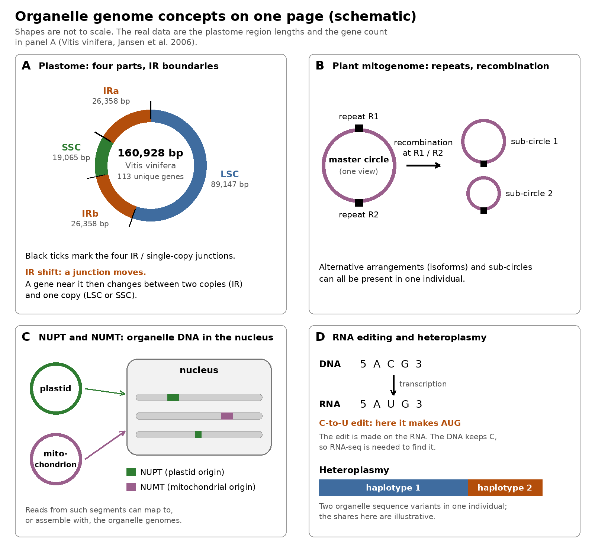

# grapevine-plastid

[English](README.md) | 中文

## 从这里开始

本仓库是一份植物质体（叶绿体）和线粒体基因组的知识库：它们的结构，如何组装、注释和绘图，以及如何处理核内拷贝（NUPT 和 NUMT）、RNA 编辑和异质性。它讲清概念，按分析步骤列出工具及其论文或仓库，并给出一条参考流程。葡萄（*Vitis*）是贯穿始终的例子。下面的各章、目录表和 shell 封装脚本是参考资料，不是持续维护的软件包。

| 我想 | 去哪里 |
|---|---|
| 了解主要概念 | [知识地图：概念](docs/KNOWLEDGE_MAP.zh.md#概念) |
| 为某一步选工具 | [知识地图：按分析步骤列工具](docs/KNOWLEDGE_MAP.zh.md#按分析步骤列工具) |
| 从读段走到一个检查过的基因组 | [知识地图：参考流程](docs/KNOWLEDGE_MAP.zh.md#参考流程) |
| 看已发表的葡萄细胞器基因组 | [知识地图：葡萄的细胞器基因组](docs/KNOWLEDGE_MAP.zh.md#葡萄的细胞器基因组)；[第 8 章](docs/08_vitis.zh.md) |
| 深入读某一个主题 | 下面的[目录](#目录) |
| 看指南图 | [`docs/figures/guide/`](docs/figures/guide/README.zh.md) |
| 复用文字、图或代码 | [`LICENSE`](LICENSE)（代码，MIT）和 [`NOTICE.zh.md`](NOTICE.zh.md)（文字和图，CC BY 4.0） |

各章和目录表在下面。

这是一份面向植物**叶绿体（质体）和线粒体基因组**的方法笔记，重点放在葡萄（*Vitis*）。仓库名字里有 plastid，但从第一页起线粒体就在范围内：组装、注释、图结构、NUMT/NUPT、RNA 编辑、遗传方式，以及细胞器泛基因组和群体数据。这里是公开的方法级整理，不含实验室未发表的组装或结果。

文中每条事实都来自本批次（2026 年 11 月 15 日，CST）实际打开过的论文或 GitHub 仓库。每章末尾有一张**论断—出处表**：论断、DOI 或网址、引用的原句或图表编号、读的是摘要还是全文。没有出处的话会删掉或标 [待确认]。阅读记录见 `SOURCES_READ.tsv`。

## 目录

| 章 | 文件（英文 / 中文） | 主要来源 |
|---|---|---|
| 1. 这两种基因组是什么 | [docs/01_overview.md](docs/01_overview.md) / [docs/01_overview.zh.md](docs/01_overview.zh.md) | Jansen 2006（全文）；Gualberto & Newton 2017（摘要）；Sloan 等 2012（全文）；Kozik 等 2019（全文）；Wu 等 2022（摘要）；Christensen 2014（全文）；JIPB 2025 葡萄尺寸（全文） |
| 2. 组装软件 | [docs/02_assembly.md](docs/02_assembly.md) / [docs/02_assembly.zh.md](docs/02_assembly.zh.md) | GetOrganelle、NOVOPlasty、Freudenthal 比较、PMAT、Oatk、HiMT、PMAT2、MitoHiFi、长读长质体组装，以及对应仓库 README |
| 3. 组装图和多种构型 | [docs/03_graphs_conformations.md](docs/03_graphs_conformations.md) / [docs/03_graphs_conformations.zh.md](docs/03_graphs_conformations.zh.md) | GetOrganelle；Kozik 2019；Fischer 等 2022；GSAT（仅摘要）；Oatk；Bandage；JIPB 图 S1 |
| 4. 注释和作图 | [docs/04_annotation_visualization.md](docs/04_annotation_visualization.md) / [docs/04_annotation_visualization.zh.md](docs/04_annotation_visualization.zh.md) | GeSeq、CPGAVAS2、PGA、OGDRAW、Chloroplot、IRscope（摘要）、ODNA |
| 5. NUMT 和 NUPT | [docs/05_numt_nupt.md](docs/05_numt_nupt.md) / [docs/05_numt_nupt.zh.md](docs/05_numt_nupt.zh.md) | 2026 年 NUPT 综述；JIPB 2025；Oatk 的细胞器间 DNA 交换 |
| 6. 异质性和 RNA 编辑 | [docs/06_heteroplasmy_rna_editing.md](docs/06_heteroplasmy_rna_editing.md) / [docs/06_heteroplasmy_rna_editing.zh.md](docs/06_heteroplasmy_rna_editing.zh.md) | NOVOPlasty；PREP-Mt；PREPACT 1（摘要）、2.0 和 3.0（全文）；Gualberto & Newton 2017；Oatk |
| 7. 遗传与核质互作 | [docs/07_inheritance_cytonuclear.md](docs/07_inheritance_cytonuclear.md) / [docs/07_inheritance_cytonuclear.zh.md](docs/07_inheritance_cytonuclear.zh.md) | Birky 2001（摘要）；JXB 2026 综述（全文）；JIPB 2025 |
| 8. 葡萄上的细胞器研究 | [docs/08_vitis.md](docs/08_vitis.md) / [docs/08_vitis.zh.md](docs/08_vitis.zh.md) | Jansen 2006；Arroyo-García 等 2006（摘要）；Zecca 等 2012（摘要）；Tabidze 等 2014（摘要）；PLOS ONE 2018；JIPB 2025；IJMS 2026（409 份品种） |
| 9. 细胞器泛基因组和群体数据 | [docs/09_pangenome_popgen.md](docs/09_pangenome_popgen.md) / [docs/09_pangenome_popgen.zh.md](docs/09_pangenome_popgen.zh.md) | JIPB 的 Grapepan_mt / Grapepan_cp；IJMS 2026；Arroyo-García 2006；Tabidze 2014 |

图是脚本画的 SVG，不是期刊原图：[figures/](figures/)，脚本是 [scripts/figures/draw_organelle_schematics.py](scripts/figures/draw_organelle_schematics.py)。

## 包装脚本

[scripts/wrappers/](scripts/wrappers/) 里的脚本只打印从各工具 README 或论文里抄来的命令，支持 `--dry-run` 和 `--help`。**本机没有用真实测序数据跑过这些大软件。** GetOrganelle、PMAT、Oatk、NOVOPlasty、HiMT 都没有在本机执行。

## 明确不当成定论的地方

- JIPB 2025 正文写道，33 份葡萄质体基因组 “TEs accounted for about 87% (Tables S4, S5)”。这句话在全文里确实存在，但我们打开的 PMC XML 里没有附表 S4、S5；这个比例也和 Jansen 等 2006 年描述的、约 16 万碱基、典型四分结构、未重排的葡萄叶绿体基因组很难对上。在读到表 S5 之前，把 87% 标为 **[待确认]**，不要当成质体组成的一般事实来用。
- 这里不提供葡萄细胞器或 LTR 的替代速率。
- 本目录不复制任何私有的葡萄线粒体项目文件。

## 目录表

[catalog/CATALOG.tsv](catalog/CATALOG.tsv) 只收进各章实际引用、并且读过的来源。`SOURCES_READ.tsv` 是更长的打开记录，也包括题目检索时碰到、但教学正文没有使用的离题文献。

## 本仓库不包含

- 非核泛基因组存在/缺失变异 (PAV) 或图形泛基因组研究: [vitis-pangenome](https://github.com/Xuzhen-Li/vitis-pangenome)
- 非理论档案或经典文献文件夹: [genomics-theory-mining](https://github.com/Xuzhen-Li/genomics-theory-mining)
- 非古DNA损伤或鉴定: [grapevine-adna](https://github.com/Xuzhen-Li/grapevine-adna)
- 非现代 167K 产物: [grapeancestry](https://github.com/Xuzhen-Li/grapeancestry)

## 后续计划更新

仅包含方法、脚本和笔记。

- 质体组装笔记
- 质体泛基因组与系统发育流程
- 数据发布后的公开数据指针

不提供未发表的基因型数据、私有坐标或样本级别的矩阵。

## 参见

- [vitis-pangenome](https://github.com/Xuzhen-Li/vitis-pangenome) - 核图形泛基因组、PAV、混合变异/剂量
- [grapevine-adna](https://github.com/Xuzhen-Li/grapevine-adna) - 损伤、鉴定、古DNA捕获
- [genomics-theory-mining](https://github.com/Xuzhen-Li/genomics-theory-mining) - 单篇经典文献、独立文件夹

**作者:** Xuzhen Li - [ORCID](https://orcid.org/0000-0003-3670-6657)
