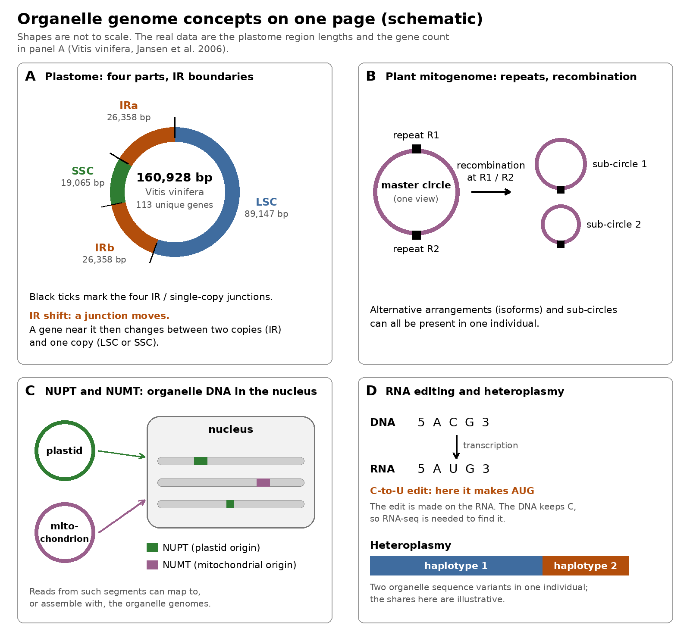

# Knowledge map

[中文](KNOWLEDGE_MAP.zh.md) · [Home page](../README.md)

This page is the entry to the repository as a knowledge base on plant plastid and mitochondrial genomes. It explains the main ideas, lists tools for each analysis step with the paper or repository behind them, and gives one reference route. Grapevine (*Vitis*) is the worked example. The chapters [`docs/01_overview.md`](01_overview.md) to [`docs/09_pangenome_popgen.md`](09_pangenome_popgen.md) and the [catalogue](../catalog/CATALOG.tsv) hold the detail for each tool; this page links to them.

Every statement on this page that cites a paper was checked against that paper (the abstract, or the full text for the figures). Statements about a tool repository were checked against that repository README. The papers are listed under [Sources used on this page](#sources-used-on-this-page). Nothing here comes from private or unpublished data.

## Contents

- [Guide figures](#guide-figures)
- [Concepts](#concepts)
- [Tools by analysis step](#tools-by-analysis-step)
- [Reference workflow](#reference-workflow)
- [Grapevine organelle genomes](#grapevine-organelle-genomes)
- [Where else to look](#where-else-to-look)
- [Sources used on this page](#sources-used-on-this-page)

## Guide figures

| # | Figure | What it shows | Source and licence |
|---|---|---|---|
| 1 | [Plastome map](figures/guide/01_plastome_map_zheng2020_fig2.jpg) | A circular plastome map of giant ragweed (*Ambrosia trifida*) with the LSC, SSC, IRa and IRb regions and their lengths, GC content, and genes coloured by function | Zheng et al. 2020, Frontiers in Genetics, Fig. 2 ([doi:10.3389/fgene.2020.576124](https://doi.org/10.3389/fgene.2020.576124)), [CC BY 4.0](https://creativecommons.org/licenses/by/4.0/), reproduced unchanged |
| 2 | [Mitochondrial isoforms](figures/guide/02_mito_isoforms_kozik2019_fig2.png) | Alternative arrangements of a plant mitochondrial genome produced by recombination at repeats (lettuce, *Lactuca*) | Kozik et al. 2019, PLOS Genetics, Fig. 2 ([doi:10.1371/journal.pgen.1008373](https://doi.org/10.1371/journal.pgen.1008373)), [CC BY 4.0](https://creativecommons.org/licenses/by/4.0/), reproduced unchanged |
| 3 | [Concepts on one page](figures/guide/03_organelle_concepts_schematic.png) | Plastome four-part layout and IR junctions, mitochondrial repeats and sub-circles, NUPT and NUMT, RNA editing and heteroplasmy | Schematic made for this repository, CC BY 4.0. Only the plastome region lengths and the count of 113 unique genes are real data (Jansen et al. 2006) |
| 4 | [Reference route](figures/guide/04_reference_route.png) | The eight steps of the [reference workflow](#reference-workflow) with example tools | Schematic made for this repository, CC BY 4.0 |

Captions and the script that draws figures 3 and 4 are in [`figures/guide/`](figures/guide/README.md).

## Concepts

### Plastome: four parts

- A plastid (chloroplast) genome of most land plants maps as one circle with four parts: a large single-copy region (LSC), a small single-copy region (SSC), and two copies of an inverted repeat (IRa and IRb) that separate them. The *Vitis vinifera* plastome is 160,928 bp, with an inverted repeat of 26,358 bp (each copy), a small single-copy region of 19,065 bp and a large single-copy region of 89,147 bp; its gene content and order are identical to many other unrearranged angiosperm plastomes, including tobacco (Jansen et al. 2006).
- Two later grapevine plastomes were reported with almost the same layout: cultivar Kyoho has 160,928 bp with LSC 89,148 bp, SSC 19,072 bp and IR 26,354 bp (Guo et al. 2020a), and its bud mutant Feng Zao has 160,927 bp (Guo et al. 2020b). Small length differences between assemblies of one species are therefore normal and are not by themselves a sign of a different structure.
- Figure 1 shows the same four-part layout as a map for another species, and figure 3, panel A, draws the *Vitis* numbers.
- In this repository: [chapter 1](01_overview.md) and the original drawing [`figures/F1_vitis_plastome_four_part.svg`](../figures/F1_vitis_plastome_four_part.svg).

### Inverted-repeat boundaries and IR shifts

- The boundaries between the inverted repeat and the single-copy regions can move between lineages. In a comparison of 69 pairs of closely related species from 52 families of angiosperms, gymnosperms and ferns, synonymous substitution rates were on average 3.7 times slower in IR genes than in single-copy genes, and genes that moved from the single-copy region into the IR showed lower rates, while genes moved from the IR into the single-copy region showed higher rates (Zhu et al. 2016).
- Junction plots make such shifts visible: IRscope draws the genetic architecture of up to ten chloroplast genomes around the sites where the inverted repeats meet the short and long single-copy regions (Amiryousefi et al. 2018), and Chloroplot can show minor mismatches between the two IR copies (Zheng et al. 2020).
- Long repeats can make complete plastome assembly from short reads difficult, leading to misassemblies and spurious rearrangements; a long-read pipeline, ptGAUL, was written for this problem (Zhou et al. 2023).
- In this repository: [chapter 3](03_graphs_conformations.md) (graphs and alternative forms) and [chapter 4](04_annotation_visualization.md) (junction plots).

### Plant mitogenomes: recombination and multipartite structure

- Angiosperm mitochondrial genomes are unusually dynamic because recombination involving repeated sequences generates subgenomic forms and genomic variation even within one species (Gualberto and Newton 2017).
- In lettuce, many repeat pairs act as recombination sites that give several alternative arrangements (isoforms); long-read and short-read data showed a complex set of isoforms in each species, microscopy of *Lactuca sativa* mitochondrial DNA showed linear, branched and circular molecules, and the authors conclude that a single circular map is not an accurate description (Kozik et al. 2019). Figure 2 reproduces their isoform figure.
- Sizes and architectures vary widely. Fully sequenced plant mitochondrial genomes span a more than 100-fold range, from 66 kb in *Viscum scurruloideum* to 11,000 kb in *Silene conica*, and some species have linear or multichromosomal genomes (Wu et al. 2022). The two largest *Silene* genomes are 6.7 and 11.3 Mb with 59 and 128 circular-mapping chromosomes (Sloan et al. 2012); the cucumber mitochondrial genome (1685 kb) maps as three largely autonomous circular chromosomes of 1556, 84 and 45 kb (Alverson et al. 2011).
- Graph-based models describe this structure directly: a master graph for rice and thale cress (He et al. 2023) and a repeat-pair model for three *Oenothera* genomes (Fischer et al. 2022).
- In grapevine, the mitochondrial genome of *V. vinifera* is 773,279 nt long and 42.4% of the *Vitis* chloroplast genome has been incorporated into it (Goremykin et al. 2009); long-read assemblies of 33 grapevine accessions range from 663.16 kb (*V. rotundifolia*) to 817.37 kb (cultivar Carmenere) with 108 to 129 genes (Hou et al. 2025).
- In this repository: [chapter 1](01_overview.md), [chapter 3](03_graphs_conformations.md) and the original drawing [`figures/F4_mitogenome_graph_schematic.svg`](../figures/F4_mitogenome_graph_schematic.svg).

### NUPT and NUMT

- NUPTs are nuclear DNA sequences of plastid origin; unlike the early bulk transfer at the origin of plastids, their formation is ongoing, with evidence for episodic formation, proliferation and long-term fixation, and a preferential overlap with some transposable-element superfamilies (Carretero-Paulet et al. 2026). In a survey of 30 angiosperm species NUPTs were formed by both continuous and episodic mechanisms (Marczuk-Rojas et al. 2025). NUMTs are the matching insertions of mitochondrial DNA; a survey of nine plant species found Numt insertions enriched in exon regions (Ko and Kim 2016).
- Six plant species, including grapevine, were compared for NUPT and NUMT size, age and position: the largest insertions were the least diverged from organelle DNA (so most recent), and their position correlated positively with transposable elements in *Arabidopsis* and sorghum but negatively in grapevine and soybean (Michalovova et al. 2013).
- In 33 grapevine accessions, long-read assemblies gave 212 to 431 NUMTs and 95 to 205 NUPTs; NUMTs were more abundant in cultivated grapes and NUPTs dominated in wild grapes (Hou et al. 2025).
- Why this matters for an organelle project: reads from nuclear copies can be mistaken for organelle reads. TIPPo was designed to reduce the influence of nuclear insertions of organellar DNA on assembly (Xian et al. 2025), and in a master-graph study NUMTs strongly affected the frequency estimates of structures in the thale cress mitogenome but only weakly in rice (He et al. 2023).
- In this repository: [chapter 5](05_numt_nupt.md).

### RNA editing

- In land plants, RNA editing in mitochondria and chloroplasts is mostly C-to-U (and U-to-C in some plants); it can change coding sequences, create AUG start codons, remove premature stop codons, and affect splicing and RNA stability (Small et al. 2020). The DNA is not changed, so editing sites are found from RNA-seq or predicted from sequence conservation.
- Prediction by conservation: PREP-Mt predicts editing at sites where an edit would raise protein conservation with homologues; on 370 sequences it classified 97.9% of 60,263 cytidines correctly, with sensitivity 82.2% (Mower 2005). The PREP suite adds PREP-Cp for chloroplast genes and PREP-Aln for alignments you provide (Mower 2009). PREPACT is a web service for analysing, predicting and cataloguing plant-type RNA editing (Lenz et al. 2018).
- Grapevine examples: RNA-seq of *V. vinifera* mitochondria supported 401 C-to-U conversions in coding regions and 44 changes in non-coding RNAs (Picardi et al. 2010); a temperature study found 122 editing sites in the chloroplast and 627 in mitochondria (Zhang et al. 2020).
- RNA editing can make gene identification hard without RNA sequence data (Lang et al. 2023), so annotation and editing are best planned together.
- In this repository: [chapter 6](06_heteroplasmy_rna_editing.md).

### Heteroplasmy

- Mitochondrial heteroplasmy is the coexistence of divergent mitochondrial genotypes in a cell; in plants the usually prevalent main genome is accompanied by substoichiometric molecules (sublimons) (Woloszynska 2010). Loss of some nuclear repair and recombination genes increases ectopic recombination, genome instability and heteroplasmy (Gualberto and Newton 2017).
- Tools that report it: NOVOPlasty includes a method for detecting intra-individual polymorphisms (Dierckxsens et al. 2020), and the Oatk paper reports insights into structural complexity, heteroplasmy and DNA exchange between organelles for 195 plant species (Zhou et al. 2025).
- In this repository: [chapter 6](06_heteroplasmy_rna_editing.md) and [chapter 7](07_inheritance_cytonuclear.md).

## Tools by analysis step

Each row says what the source says the tool does. Whether a tool works for a given grape data set is not claimed here; the existing chapters list the caveats each README gives. The `scripts/wrappers/` files only print commands and have not been run on real reads (see the [home page](../README.md#software-wrappers)).

### Assembly

| Tool | What it does | Data | Source |
|---|---|---|---|
| GetOrganelle | Recruits organelle reads by baiting and iterative mapping, assembles, filters and disentangles the graph, and gives all possible circular configurations; 47 of 50 published plant data sets reassembled as circular plastomes | Short reads | Jin et al. 2020; [Kinggerm/GetOrganelle](https://github.com/Kinggerm/GetOrganelle) |
| NOVOPlasty | Seed-and-extend assembler for organelle genomes from whole-genome data; README: assembler and heteroplasmy caller for short circular genomes | Illumina whole-genome reads | Dierckxsens et al. 2017; [ndierckx/NOVOPlasty](https://github.com/ndierckx/NOVOPlasty) |
| Plastome assembler comparison | Benchmark of seven chloroplast assembly tools; assembled 20 new chloroplast genomes from 105 data sets of species with unknown plastomes | Illumina paired-end reads | Freudenthal et al. 2020 |
| ptGAUL | Pipeline for plastome assembly from long reads, aimed at plastomes with long repeats | ONT or PacBio | Zhou et al. 2023 |
| PMAT | Plant mitogenome assembly from low-coverage HiFi data; applied to 13 plant mitogenomes; 1x HiFi coverage was enough in the authors’ tests; README: HiFi, CLR or ONT, can also assemble chloroplast genomes | HiFi (also CLR, ONT) | Bi et al. 2024; [bichangwei/PMAT](https://github.com/bichangwei/PMAT) |
| Oatk | Syncmer-based assembly graph, profile-HMM organelle identification and best-path search; high-quality assemblies for 195 plant species; README: wrapper runs syncasm, hmmannot and pathfinder | HiFi, ONT duplex or error-corrected ONT | Zhou et al. 2025; [c-zhou/oatk](https://github.com/c-zhou/oatk) |
| TIPPo | Reference-free HiFi assembly with a deep-learning read classifier and k-mer filtering; 54 complete chloroplast genomes; comparable with PMAT for most mitogenomes | PacBio HiFi | Xian et al. 2025; [Wenfei-Xian/TIPP](https://github.com/Wenfei-Xian/TIPP) |
| HiMT | One-click chloroplast and mitochondrial assembly from HiFi reads with a graphical interface | HiFi | Tang et al. 2025; [tang-shuyuan/HiMT](https://github.com/tang-shuyuan/HiMT) |
| MitoHiFi | Mitogenome assembly and annotation from HiFi reads or contigs; used for 374 animal and fungal mitogenomes; README section 6: still not optimized for plant mitochondria or chloroplasts, but `-c` can finish a contig you consider to be one | HiFi | Uliano-Silva et al. 2023; [marcelauliano/MitoHiFi](https://github.com/marcelauliano/MitoHiFi) |

More detail and caveats: [chapter 2](02_assembly.md).

### Assembly graphs and alternative forms

| Tool | What it does | Source |
|---|---|---|
| Bandage | Draws assembly graphs with their connections; BLAST searches can be run inside it and shown as highlights | Wick et al. 2015; [rrwick/Bandage](https://github.com/rrwick/Bandage) |
| SAGBAC | Identifies recombining repeat pairs and reconstructs plant mitochondrial genomes as a graph (applied to three *Oenothera* genomes) | Fischer et al. 2022 |
| GSAT | Graph-based toolkit that builds mitochondrial master graphs; applied to rice and thale cress | He et al. 2023 |

More detail: [chapter 3](03_graphs_conformations.md).

### Annotation

| Tool | What it does | Source |
|---|---|---|
| GeSeq | Web application for organellar genomes, mainly chloroplasts; BLAT homology plus profile-HMM searches and two tRNA predictors; GenBank output that OGDRAW can draw | Tillich et al. 2017; [web server](https://chlorobox.mpimp-golm.mpg.de/geseq.html) |
| PGA | Command-line plastome annotator that uses reference plastomes as the query and the new plastome as the subject (reverse query-subject BLAST) | Qu et al. 2019; [quxiaojian/PGA](https://github.com/quxiaojian/PGA) |
| CPGAVAS2 | Plastome annotation web server with two reference sets, new algorithms for small exons and trans-splicing genes, and repeat display | Shi et al. 2019; [cliu6688/CPGAVAS2](https://github.com/cliu6688/CPGAVAS2) |
| PMGA | Plant mitochondrial annotation for several contigs at once, including mitochondrial plastid DNA and RNA editing sites (through Deepred-Mt); in the authors’ comparison on *Arabidopsis thaliana* and *Liriodendron tulipifera* it made fewer annotation errors than AGORA, GeSeq and MFannot; works best for angiosperms | Li et al. 2025; web server given in the paper |
| MFannot | Annotation of mitochondrial genomes (and plastid genomes) with profile HMMs, covariance models and intron detection; its web page says annotation of plant mitochondrial genomes is less effective | Lang et al. 2023; [MFannotWeb](https://megasun.bch.umontreal.ca/apps/mfannotweb/about) |
| AGORA | BLAST-based annotation of mitochondrial and plastid genomes of eukaryotes against references from NCBI or your own | Jung et al. 2018; [web application](https://bigdata.dongguk.edu/gene_project/AGORA/) |

More detail: [chapter 4](04_annotation_visualization.md).

### NUPT and NUMT detection, and organelle contamination

| Tool or method | What it does | Source |
|---|---|---|
| BLASTN (BLAST+) | The nuclear genomes of 30 angiosperms were scanned for NUPTs with BLASTN, using the plastid genome as the query; nine plant species were scanned for Numts with BLASTN | Camacho et al. 2009; Marczuk-Rojas et al. 2025; Ko and Kim 2016 |
| Chlomito | Separates organelle contamination in a nuclear assembly from true transferred sequence with two metrics, alignment-length coverage ratio and sequencing-depth ratio | Song et al. 2024; [songwei-hxb/chlomito](https://github.com/songwei-hxb/chlomito) |
| ODNA | Classifies organellar DNA sequences inside a genome assembly by machine learning | Martin et al. 2023; [code](https://gitlab.com/mosga/odna) |
| TIPPo | After assembling the organelle genomes, the authors used them to find NUPT and NUMT insertions | Xian et al. 2025 |
| HiFi assemblies of grapevine | NUMTs and NUPTs counted per accession with long-read nuclear and organelle assemblies | Hou et al. 2025 |

More detail: [chapter 5](05_numt_nupt.md).

### RNA-editing calling and prediction

| Tool | What it does | Source |
|---|---|---|
| REDO | Perl suite that finds RNA editing in plant organelles from variant calls (VCF) of RNA-seq data; annotates each site in the RNA | Wu et al. 2018 |
| RES-Scanner | Detects and annotates editing sites with matching RNA-seq and DNA-seq from the same samples | Wang et al. 2016; [ZhangLabSZ/RES-Scanner](https://github.com/ZhangLabSZ/RES-Scanner) |
| Deepred-Mt | Deep-learning prediction of C-to-U editing in plant mitochondria | Edera et al. 2021; [aedera/deepredmt](https://github.com/aedera/deepredmt) |
| PREP-Mt and PREPACT | Prediction from sequence conservation (PREP-Mt) and a web service for analysing and cataloguing plant-type editing, with U-to-C options (PREPACT 3.0) | Mower 2005; Lenz et al. 2018 |
| REDItools | Suite of Python scripts for high-throughput detection of RNA editing from next-generation sequencing data; the abstract does not limit it to plant organelles | Picardi and Pesole 2013 |
| PREP suite | Web editors that predict C-to-U sites from the conservation of proteins across species: PREP-Mt for mitochondrial genes, PREP-Cp for chloroplast genes and PREP-Aln for alignments you provide | Mower 2009 |

Calling from RNA-seq needs reads mapped to the organelle assembly and, where possible, matching DNA reads, because genome variants and read errors can look like edits (Wang et al. 2016; Wu et al. 2018). More detail: [chapter 6](06_heteroplasmy_rna_editing.md).

### Visualisation

| Tool | What it does | Source |
|---|---|---|
| OGDRAW | Draws graphical maps of plastid and mitochondrial genomes from GenBank files, for single genomes or many | Greiner et al. 2019; [web server](https://chlorobox.mpimp-golm.mpg.de/OGDraw.html) |
| CPGView | Draws maps of gene distribution with variable sites and repeats, of the structure of cis-splicing genes, and of the trans-splicing gene *rps12*; on 5998 public chloroplast genomes it plotted maps for 5882, and the 116 it failed on had annotation errors | Liu et al. 2023 |
| Chloroplot | Shiny app for chloroplast maps with SSC shown in reverse complement, optional codon usage index and IR mismatches | Zheng et al. 2020 |
| IRscope | Junction plots of up to ten chloroplast genomes at the IR and single-copy boundaries | Amiryousefi et al. 2018 |
| Bandage | Assembly graph view (see above) | Wick et al. 2015 |

## Reference workflow

One route from sequencing data to a checked organelle genome. Figure 4 draws it; the wrappers in [`scripts/wrappers/`](../scripts/wrappers/) show example commands for steps 2 and 3.

1. **Data and question.** Decide whether you need the plastome, the mitogenome or both, and whether editing matters (then plan RNA-seq). Short reads suit plastomes; long reads help when repeats or recombination matter (Zhou et al. 2023; Kozik et al. 2019).
2. **Plastome assembly.** GetOrganelle or NOVOPlasty from short reads; ptGAUL from long reads. In the seven-assembler benchmark of Freudenthal et al. (2020), GetOrganelle is the recommended default, Fast-Plast the back-up if it fails, and NOVOPlasty or manual parameter tuning if both fail.
3. **Mitogenome assembly.** Oatk, PMAT, TIPPo or HiMT from HiFi reads; GetOrganelle can also assemble mitochondrial genomes from short reads (Jin et al. 2020). MitoHiFi, built for animal and fungal mitogenomes, can finish a contig that you consider to be a plant mitogenome (its README, section 6; Uliano-Silva et al. 2023). Expect a graph, not one circle.
4. **Check the graph.** Open it in Bandage; use repeat-pair or master-graph models (SAGBAC, GSAT) to list the alternative forms, and keep them instead of forcing one circle.
5. **Annotate.** Plastome: GeSeq, PGA or CPGAVAS2. Mitogenome: PMGA first for angiosperms, with MFannot, AGORA or GeSeq as cross-checks. Check intron-containing and trans-spliced genes by hand.
6. **Maps and IR junctions.** Draw maps with OGDRAW or Chloroplot, add exon, intron and repeat detail with CPGView, plot the IR junctions with IRscope, and compare lengths and gene order with the published *Vitis* genomes below.
7. **Nuclear insertions.** Search the nuclear assembly with BLASTN using the organelle genomes as queries, remove organelle contamination with Chlomito or ODNA where needed, and label NUPT and NUMT segments (Marczuk-Rojas et al. 2025; Song et al. 2024).
8. **RNA editing and heteroplasmy.** Call editing sites from RNA-seq with REDO, RES-Scanner or REDItools and predict with Deepred-Mt, the PREP suite or PREPACT; report heteroplasmic variants from NOVOPlasty or Oatk output with their read support.

## Grapevine organelle genomes

Published organelle genomes and data sets used as the worked example. Lengths and counts are from the abstract or text of the cited paper.

| Genome or data set | What it is | Source and record |
|---|---|---|
| *V. vinifera* cultivar Maxxa plastome | 160,928 bp, complete; GenBank [DQ424856](https://www.ncbi.nlm.nih.gov/nuccore/DQ424856), RefSeq [NC_007957](https://www.ncbi.nlm.nih.gov/nuccore/NC_007957) | Jansen et al. 2006 |
| *V. vinifera* mitochondrial genome | 773,279 nt, complete; RefSeq [NC_012119](https://www.ncbi.nlm.nih.gov/nuccore/NC_012119) | Goremykin et al. 2009 |
| Kyoho and Feng Zao plastomes | 160,928 bp and 160,927 bp | Guo et al. 2020a, 2020b |
| Eleven cultivars, plastome resequencing | Eight Georgian and three French cultivars in four haplogroups (AAA, ATT, ATA, GTA), compared with Maxxa | Tabidze et al. 2014 |
| Two Georgian wild grapevine plastomes | 160,928 bp each, 128 genes, haplotype AAA | Pipia et al. 2024 |
| 409 cultivars, plastome SNV profile | Shotgun sequencing; 102 haplotypes with geographic structure | Rudolf Pilih et al. 2026 |
| 33 wild and cultivated accessions | Pan-mitogenome, pan-plastome and nuclear genomes from long reads; mitogenomes 663.16 to 817.37 kb; plastomes 159,011 to 163,619 bp | Hou et al. 2025 |
| RNA editing in grape | Mitochondrial editing from RNA-seq (Picardi et al. 2010); chloroplast and mitochondrial editing under temperature change (Zhang et al. 2020) | see Concepts |
| NUPT and NUMT in grapevine | Six-species comparison including grapevine (Michalovova et al. 2013); 33 accessions (Hou et al. 2025) | see Concepts |

The 33-accession paper and the older cultivar papers are discussed in [chapter 8](08_vitis.md) and [chapter 9](09_pangenome_popgen.md).

## Where else to look

- Nuclear pangenome graphs, PAV and dosage: [vitis-pangenome](https://github.com/Xuzhen-Li/vitis-pangenome).
- Ancient DNA damage and authentication: [grapevine-adna](https://github.com/Xuzhen-Li/grapevine-adna).
- One classic paper per folder: [genomics-theory-mining](https://github.com/Xuzhen-Li/genomics-theory-mining).

## Sources used on this page

| Source | Paper | DOI |
|---|---|---|
| Alverson et al. 2011 | Origins and recombination of the bacterial-sized multichromosomal mitochondrial genome of cucumber. Plant Cell | [10.1105/tpc.111.087189](https://doi.org/10.1105/tpc.111.087189) |
| Amiryousefi et al. 2018 | IRscope: an online program to visualize the junction sites of chloroplast genomes. Bioinformatics | [10.1093/bioinformatics/bty220](https://doi.org/10.1093/bioinformatics/bty220) |
| Bi et al. 2024 | PMAT: an efficient plant mitogenome assembly toolkit using low-coverage HiFi sequencing data. Horticulture Research | [10.1093/hr/uhae023](https://doi.org/10.1093/hr/uhae023) |
| Camacho et al. 2009 | BLAST+: architecture and applications. BMC Bioinformatics | [10.1186/1471-2105-10-421](https://doi.org/10.1186/1471-2105-10-421) |
| Carretero-Paulet et al. 2026 | Nuclear DNA of plastid origin (NUPTs), neglected driver of genome variation and evolutionary innovation. The Plant Journal | [10.1111/tpj.70685](https://doi.org/10.1111/tpj.70685) |
| Dierckxsens et al. 2017 | NOVOPlasty: de novo assembly of organelle genomes from whole genome data. Nucleic Acids Research | [10.1093/nar/gkw955](https://doi.org/10.1093/nar/gkw955) |
| Dierckxsens et al. 2020 | Unraveling heteroplasmy patterns with NOVOPlasty. NAR Genomics and Bioinformatics | [10.1093/nargab/lqz011](https://doi.org/10.1093/nargab/lqz011) |
| Edera et al. 2021 | Deepred-Mt: deep representation learning for predicting C-to-U RNA editing in plant mitochondria. Computers in Biology and Medicine | [10.1016/j.compbiomed.2021.104682](https://doi.org/10.1016/j.compbiomed.2021.104682) |
| Fischer et al. 2022 | Graph-based models of the *Oenothera* mitochondrial genome capture the enormous complexity of higher plant mitochondrial DNA organization. NAR Genomics and Bioinformatics | [10.1093/nargab/lqac027](https://doi.org/10.1093/nargab/lqac027) |
| Freudenthal et al. 2020 | A systematic comparison of chloroplast genome assembly tools. Genome Biology | [10.1186/s13059-020-02153-6](https://doi.org/10.1186/s13059-020-02153-6) |
| Goremykin et al. 2009 | Mitochondrial DNA of *Vitis vinifera* and the issue of rampant horizontal gene transfer. Molecular Biology and Evolution | [10.1093/molbev/msn226](https://doi.org/10.1093/molbev/msn226) |
| Greiner et al. 2019 | OrganellarGenomeDRAW (OGDRAW) version 1.3.1: expanded toolkit for the graphical visualization of organellar genomes. Nucleic Acids Research | [10.1093/nar/gkz238](https://doi.org/10.1093/nar/gkz238) |
| Gualberto and Newton 2017 | Plant mitochondrial genomes: dynamics and mechanisms of mutation. Annual Review of Plant Biology | [10.1146/annurev-arplant-043015-112232](https://doi.org/10.1146/annurev-arplant-043015-112232) |
| Guo et al. 2020a | The complete chloroplast genome sequence of *Vitis vinifera* ‘Kyoho’. Mitochondrial DNA Part B | [10.1080/23802359.2020.1749166](https://doi.org/10.1080/23802359.2020.1749166) |
| Guo et al. 2020b | The complete chloroplast genome sequence of *Vitis vinifera* ‘Feng Zao’. Mitochondrial DNA Part B | [10.1080/23802359.2020.1749167](https://doi.org/10.1080/23802359.2020.1749167) |
| He et al. 2023 | Master graph: an essential integrated assembly model for the plant mitogenome based on a graph-based framework. Briefings in Bioinformatics | [10.1093/bib/bbac522](https://doi.org/10.1093/bib/bbac522) |
| Hou et al. 2025 | The cytonuclear interactions during grapevine domestication. Journal of Integrative Plant Biology | [10.1111/jipb.13968](https://doi.org/10.1111/jipb.13968) |
| Jansen et al. 2006 | Phylogenetic analyses of *Vitis* (Vitaceae) based on complete chloroplast genome sequences: effects of taxon sampling and phylogenetic methods on resolving relationships among rosids. BMC Evolutionary Biology | [10.1186/1471-2148-6-32](https://doi.org/10.1186/1471-2148-6-32) |
| Jin et al. 2020 | GetOrganelle: a fast and versatile toolkit for accurate de novo assembly of organelle genomes. Genome Biology | [10.1186/s13059-020-02154-5](https://doi.org/10.1186/s13059-020-02154-5) |
| Jung et al. 2018 | AGORA: organellar genome annotation from the amino acid and nucleotide references. Bioinformatics | [10.1093/bioinformatics/bty196](https://doi.org/10.1093/bioinformatics/bty196) |
| Ko and Kim 2016 | Analysis of nuclear mitochondrial DNA segments of nine plant species: size, distribution, and insertion loci. Genomics & Informatics | [10.5808/gi.2016.14.3.90](https://doi.org/10.5808/gi.2016.14.3.90) |
| Kozik et al. 2019 | The alternative reality of plant mitochondrial DNA: one ring does not rule them all. PLOS Genetics | [10.1371/journal.pgen.1008373](https://doi.org/10.1371/journal.pgen.1008373) |
| Lang et al. 2023 | Mitochondrial genome annotation with MFannot: a critical analysis of gene identification and gene model prediction. Frontiers in Plant Science | [10.3389/fpls.2023.1222186](https://doi.org/10.3389/fpls.2023.1222186) |
| Lenz et al. 2018 | Plant organelle RNA editing and its specificity factors: enhancements of analyses and new database features in PREPACT 3.0. BMC Bioinformatics | [10.1186/s12859-018-2244-9](https://doi.org/10.1186/s12859-018-2244-9) |
| Li et al. 2025 | PMGA: a plant mitochondrial genome annotator. Plant Communications | [10.1016/j.xplc.2024.101191](https://doi.org/10.1016/j.xplc.2024.101191) |
| Liu et al. 2023 | CPGView: a package for visualizing detailed chloroplast genome structures. Molecular Ecology Resources | [10.1111/1755-0998.13729](https://doi.org/10.1111/1755-0998.13729) |
| Marczuk-Rojas et al. 2025 | Episodic and ongoing mechanisms drive plastid-derived nuclear DNA evolution in angiosperms. Genome Biology and Evolution | [10.1093/gbe/evaf194](https://doi.org/10.1093/gbe/evaf194) |
| Martin et al. 2023 | ODNA: identification of organellar DNA by machine learning. Bioinformatics | [10.1093/bioinformatics/btad326](https://doi.org/10.1093/bioinformatics/btad326) |
| Michalovova et al. 2013 | Analysis of plastid and mitochondrial DNA insertions in the nucleus (NUPTs and NUMTs) of six plant species: size, relative age and chromosomal localization. Heredity | [10.1038/hdy.2013.51](https://doi.org/10.1038/hdy.2013.51) |
| Mower 2005 | PREP-Mt: predictive RNA editor for plant mitochondrial genes. BMC Bioinformatics | [10.1186/1471-2105-6-96](https://doi.org/10.1186/1471-2105-6-96) |
| Mower 2009 | The PREP suite: predictive RNA editors for plant mitochondrial genes, chloroplast genes and user-defined alignments. Nucleic Acids Research | [10.1093/nar/gkp337](https://doi.org/10.1093/nar/gkp337) |
| Picardi and Pesole 2013 | REDItools: high-throughput RNA editing detection made easy. Bioinformatics | [10.1093/bioinformatics/btt287](https://doi.org/10.1093/bioinformatics/btt287) |
| Picardi et al. 2010 | Large-scale detection and analysis of RNA editing in grape mtDNA by RNA deep-sequencing. Nucleic Acids Research | [10.1093/nar/gkq202](https://doi.org/10.1093/nar/gkq202) |
| Pipia et al. 2024 | Plastid genomics of wild grapevines (*Vitis vinifera* subsp. *sylvestris*) of Georgia the cradle of viticulture. OENO One | [10.20870/oeno-one.2024.58.4.8087](https://doi.org/10.20870/oeno-one.2024.58.4.8087) |
| Qu et al. 2019 | PGA: a software package for rapid, accurate, and flexible batch annotation of plastomes. Plant Methods | [10.1186/s13007-019-0435-7](https://doi.org/10.1186/s13007-019-0435-7) |
| Rudolf Pilih et al. 2026 | High-resolution chloroplast SNV profiling of 409 grapevine (*Vitis vinifera* L.) cultivars using whole-genome shotgun sequencing. International Journal of Molecular Sciences | [10.3390/ijms27031583](https://doi.org/10.3390/ijms27031583) |
| Shi et al. 2019 | CPGAVAS2, an integrated plastome sequence annotator and analyzer. Nucleic Acids Research | [10.1093/nar/gkz345](https://doi.org/10.1093/nar/gkz345) |
| Sloan et al. 2012 | Rapid evolution of enormous, multichromosomal genomes in flowering plant mitochondria with exceptionally high mutation rates. PLoS Biology | [10.1371/journal.pbio.1001241](https://doi.org/10.1371/journal.pbio.1001241) |
| Small et al. 2020 | Plant organellar RNA editing: what 30 years of research has revealed. The Plant Journal | [10.1111/tpj.14578](https://doi.org/10.1111/tpj.14578) |
| Song et al. 2024 | Chlomito: a novel tool for precise elimination of organelle genome contamination from nuclear genome assembly. Frontiers in Plant Science | [10.3389/fpls.2024.1430443](https://doi.org/10.3389/fpls.2024.1430443) |
| Tabidze et al. 2014 | The complete chloroplast DNA sequence of eleven grape cultivars. Simultaneous resequencing methodology. OENO One | [10.20870/oeno-one.2014.48.2.1568](https://doi.org/10.20870/oeno-one.2014.48.2.1568) |
| Tang et al. 2025 | HiMT: an integrative toolkit for assembling organelle genomes using HiFi reads. Plant Communications | [10.1016/j.xplc.2025.101467](https://doi.org/10.1016/j.xplc.2025.101467) |
| Tillich et al. 2017 | GeSeq: versatile and accurate annotation of organelle genomes. Nucleic Acids Research | [10.1093/nar/gkx391](https://doi.org/10.1093/nar/gkx391) |
| Uliano-Silva et al. 2023 | MitoHiFi: a python pipeline for mitochondrial genome assembly from PacBio high fidelity reads. BMC Bioinformatics | [10.1186/s12859-023-05385-y](https://doi.org/10.1186/s12859-023-05385-y) |
| Wang et al. 2016 | RES-Scanner: a software package for genome-wide identification of RNA-editing sites. GigaScience | [10.1186/s13742-016-0143-4](https://doi.org/10.1186/s13742-016-0143-4) |
| Wick et al. 2015 | Bandage: interactive visualization of de novo genome assemblies. Bioinformatics | [10.1093/bioinformatics/btv383](https://doi.org/10.1093/bioinformatics/btv383) |
| Woloszynska 2010 | Heteroplasmy and stoichiometric complexity of plant mitochondrial genomes: though this be madness, yet there’s method in’t. Journal of Experimental Botany | [10.1093/jxb/erp361](https://doi.org/10.1093/jxb/erp361) |
| Wu et al. 2018 | REDO: RNA editing detection in plant organelles based on variant calling results. Journal of Computational Biology | [10.1089/cmb.2017.0214](https://doi.org/10.1089/cmb.2017.0214) |
| Wu et al. 2022 | Genomic architectural variation of plant mitochondria: a review of multichromosomal structuring. Journal of Systematics and Evolution | [10.1111/jse.12655](https://doi.org/10.1111/jse.12655) |
| Xian et al. 2025 | TIPPo: a user-friendly tool for de novo assembly of organellar genomes with high-fidelity data. Molecular Biology and Evolution | [10.1093/molbev/msae247](https://doi.org/10.1093/molbev/msae247) |
| Zhang et al. 2020 | Dynamic response of RNA editing to temperature in grape by RNA deep sequencing. Functional & Integrative Genomics | [10.1007/s10142-019-00727-7](https://doi.org/10.1007/s10142-019-00727-7) |
| Zheng et al. 2020 | Chloroplot: an online program for the versatile plotting of organelle genomes. Frontiers in Genetics | [10.3389/fgene.2020.576124](https://doi.org/10.3389/fgene.2020.576124) |
| Zhou et al. 2023 | Plastid genome assembly using long-read data. Molecular Ecology Resources | [10.1111/1755-0998.13787](https://doi.org/10.1111/1755-0998.13787) |
| Zhou et al. 2025 | Oatk: a de novo assembly tool for complex plant organelle genomes. Genome Biology | [10.1186/s13059-025-03676-6](https://doi.org/10.1186/s13059-025-03676-6) |
| Zhu et al. 2016 | Evolutionary dynamics of the plastid inverted repeat: the effects of expansion, contraction, and loss on substitution rates. New Phytologist | [10.1111/nph.13743](https://doi.org/10.1111/nph.13743) |
