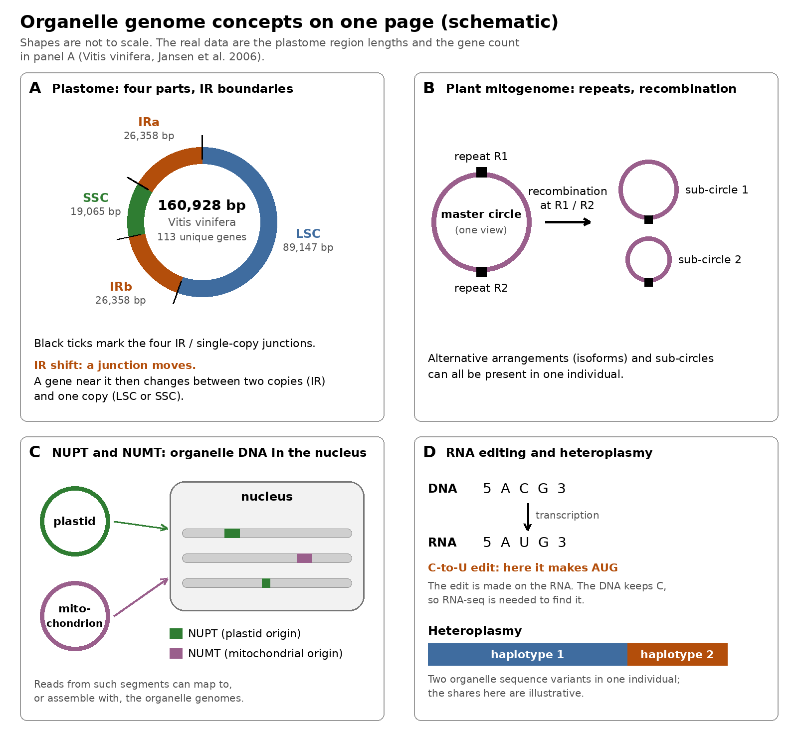

# 知识地图

[English](KNOWLEDGE_MAP.md) · [主页](../README.md)

本页是把本仓库当作植物质体和线粒体基因组知识库的入口：讲清主要概念，按分析步骤列出工具及其论文或仓库，并给出一条参考流程。葡萄（*Vitis*）是贯穿始终的例子。每个工具更细的内容在 [`docs/01_overview.zh.md`](01_overview.zh.md) 到 [`docs/09_pangenome_popgen.zh.md`](09_pangenome_popgen.zh.md) 和[目录表](../catalog/CATALOG.tsv)里，本页都给出链接。

本页凡是引用论文的句子，都对照该论文核对过（摘要，图则核对全文）。涉及工具仓库的句子对照该仓库的 README。论文列在[本页用到的来源](#本页用到的来源)。这里没有任何私有或未发表的数据。

## 目录

- [指南图](#指南图)
- [概念](#概念)
- [按分析步骤列工具](#按分析步骤列工具)
- [参考流程](#参考流程)
- [葡萄的细胞器基因组](#葡萄的细胞器基因组)
- [还可以去哪里看](#还可以去哪里看)
- [本页用到的来源](#本页用到的来源)

## 指南图

| 编号 | 图 | 内容 | 来源与许可 |
|---|---|---|---|
| 1 | [质体基因组图](figures/guide/01_plastome_map_zheng2020_fig2.jpg) | 豚草（*Ambrosia trifida*）的环状质体基因组图：LSC、SSC、IRa、IRb 四个区及其长度、GC 含量，基因按功能着色 | Zheng 等 2020，Frontiers in Genetics，图 2（[doi:10.3389/fgene.2020.576124](https://doi.org/10.3389/fgene.2020.576124)），[CC BY 4.0](https://creativecommons.org/licenses/by/4.0/)，原样转载 |
| 2 | [线粒体异构体](figures/guide/02_mito_isoforms_kozik2019_fig2.png) | 重复序列处重组产生的植物线粒体基因组不同排列方式（莴苣属 *Lactuca*） | Kozik 等 2019，PLOS Genetics，图 2（[doi:10.1371/journal.pgen.1008373](https://doi.org/10.1371/journal.pgen.1008373)），[CC BY 4.0](https://creativecommons.org/licenses/by/4.0/)，原样转载 |
| 3 | [概念总览](figures/guide/03_organelle_concepts_schematic.png) | 质体基因组四段结构与 IR 边界、线粒体重复序列与子环、NUPT 与 NUMT、RNA 编辑与异质性 | 为本仓库绘制的示意图，CC BY 4.0。只有质体各区长度和 113 个不重复基因这一计数是真实数据（Jansen 等 2006） |
| 4 | [参考流程图](figures/guide/04_reference_route.png) | [参考流程](#参考流程)的八个步骤和示例工具 | 为本仓库绘制的示意图，CC BY 4.0 |

图注和绘制图 3、图 4 的脚本在 [`figures/guide/`](figures/guide/README.zh.md)。

## 概念

### 质体基因组：四段结构

- 大多数陆地植物的质体（叶绿体）基因组呈一个环，分四段：大单拷贝区（LSC）、小单拷贝区（SSC），以及把它们隔开的两份反向重复（IRa 和 IRb）。酿酒葡萄（*Vitis vinifera*）质体基因组长 160,928 bp，反向重复每份 26,358 bp，小单拷贝区 19,065 bp，大单拷贝区 89,147 bp；基因内容和顺序与烟草等许多未重排的被子植物质体基因组相同（Jansen 等 2006）。
- 之后报道的两个葡萄质体基因组布局几乎一样：Kyoho 长 160,928 bp，LSC 89,148 bp，SSC 19,072 bp，IR 26,354 bp（Guo 等 2020a）；它的芽变 Feng Zao 长 160,927 bp（Guo 等 2020b）。所以同一物种不同组装之间差几个碱基是常见的，本身不说明结构不同。
- 图 1 把同样的四段结构画成了另一个物种的图谱，图 3 的 A 图画了 *Vitis* 的数字。
- 本仓库：[第 1 章](01_overview.zh.md)，以及原创绘图 [`figures/F1_vitis_plastome_four_part.svg`](../figures/F1_vitis_plastome_four_part.svg)。

### 反向重复边界与 IR 移动

- 反向重复与单拷贝区之间的边界在不同类群里可以移动。比较 52 个科的被子植物、裸子植物和蕨类中 69 对近缘种后发现，IR 内基因的同义替换速率平均比单拷贝区基因慢 3.7 倍；从单拷贝区移入 IR 的基因速率变低，从 IR 移出到单拷贝区的基因速率变高（Zhu 等 2016）。
- 连接点图可以把这类移动画出来：IRscope 能画出最多十个叶绿体基因组在反向重复与短、长单拷贝区连接处附近的结构（Amiryousefi 等 2018）；Chloroplot 能显示两份 IR 之间的少量错配（Zheng 等 2020）。
- 长重复序列会使短读长组装完整质体基因组变难，出现错误组装和假的重排；ptGAUL 就是为用长读长解决这个问题而写的流程（Zhou 等 2023）。
- 本仓库：[第 3 章](03_graphs_conformations.zh.md)（图结构与替代构型）和[第 4 章](04_annotation_visualization.zh.md)（连接点图）。

### 植物线粒体基因组：重组与多分子结构

- 被子植物线粒体基因组异常多变，因为涉及重复序列的重组会产生亚基因组形式，在同一物种内也有很大变异（Gualberto 和 Newton 2017）。
- 在莴苣中，许多重复序列对是重组位点，产生多种排列方式（异构体）；长读长和短读长数据显示每个物种都有一组复杂的异构体，*Lactuca sativa* 线粒体 DNA 的显微观察看到线状、分支和环状分子，作者的结论是单个环状图并不能准确描述它（Kozik 等 2019）。图 2 转载了他们的异构体图。
- 大小和结构差别很大。已完整测序的植物线粒体基因组大小跨度超过 100 倍，从 *Viscum scurruloideum* 的 66 kb 到 *Silene conica* 的 11,000 kb，有些物种是线状或多染色体的基因组（Wu 等 2022）。*Silene* 最大的两个基因组为 6.7 和 11.3 Mb，分别有 59 和 128 个环状映射染色体（Sloan 等 2012）；黄瓜线粒体基因组（1685 kb）呈三个基本自主的环状染色体，长 1556、84 和 45 kb（Alverson 等 2011）。
- 图模型可以直接描述这种结构：水稻和拟南芥的主图（He 等 2023），以及三个月见草（*Oenothera*）基因组的重复序列对模型（Fischer 等 2022）。
- 葡萄方面：*V. vinifera* 线粒体基因组长 773,279 nt，*Vitis* 叶绿体基因组的 42.4% 已整合进来（Goremykin 等 2009）；33 份葡萄材料的长读长组装中，线粒体基因组从 663.16 kb（*V. rotundifolia*）到 817.37 kb（品种 Carmenere），含 108 到 129 个基因（Hou 等 2025）。
- 本仓库：[第 1 章](01_overview.zh.md)、[第 3 章](03_graphs_conformations.zh.md)，以及原创绘图 [`figures/F4_mitogenome_graph_schematic.svg`](../figures/F4_mitogenome_graph_schematic.svg)。

### NUPT 与 NUMT

- NUPT 是核基因组中来自质体的 DNA 序列；与质体起源时的那次大规模转移不同，它们的形成是一个持续的过程，有证据表明存在阶段性形成、扩增和长期固定，并且倾向与某些转座子超家族重叠（Carretero-Paulet 等 2026）。对 30 个被子植物物种的调查显示，NUPT 由持续和阶段性两种机制共同形成（Marczuk-Rojas 等 2025）。NUMT 是对应的线粒体 DNA 插入；对九个植物物种的调查发现 Numt 插入在外显子区域富集（Ko 和 Kim 2016）。
- 对包括葡萄在内的六个植物物种比较了 NUPT 和 NUMT 的大小、年龄和位置：最大的插入与细胞器 DNA 差异最小（即最近发生），它们的位置在拟南芥和高粱中与转座子正相关，在葡萄和大豆中负相关（Michalovova 等 2013）。
- 在 33 份葡萄材料的长读长组装中，NUMT 有 212 到 431 个，NUPT 有 95 到 205 个；栽培葡萄中 NUMT 更多，野生葡萄中 NUPT 占优（Hou 等 2025）。
- 对细胞器项目的意义：来自核拷贝的读段可能被误当成细胞器读段。TIPPo 的设计目标之一就是降低核内细胞器 DNA 插入对组装的影响（Xian 等 2025）；在一项主图研究中，NUMT 对拟南芥线粒体基因组结构频率的估计影响很大，对水稻影响较弱（He 等 2023）。
- 本仓库：[第 5 章](05_numt_nupt.zh.md)。

### RNA 编辑

- 在陆地植物中，线粒体和叶绿体的 RNA 编辑主要是 C 到 U（有些植物还有 U 到 C）；它可以改变编码序列、产生 AUG 起始密码子、消除提前出现的终止密码子，并影响剪接和 RNA 稳定性（Small 等 2020）。DNA 本身不变，所以编辑位点要靠 RNA-seq 找出，或根据序列保守性预测。
- 靠保守性预测：PREP-Mt 在编辑会提高蛋白与同源蛋白保守性的位置预测编辑；在 370 条序列上，60,263 个胞嘧啶中 97.9% 分类正确，灵敏度 82.2%（Mower 2005）。PREP suite 另有用于叶绿体基因的 PREP-Cp 和用于自备比对的 PREP-Aln（Mower 2009）。PREPACT 是用于分析、预测和整理植物型 RNA 编辑的网络服务（Lenz 等 2018）。
- 葡萄的例子：*V. vinifera* 线粒体的 RNA-seq 支持编码区 401 个 C 到 U 转换和非编码 RNA 中另外 44 个修饰（Picardi 等 2010）；一项温度研究在叶绿体中发现 122 个编辑位点，在线粒体中发现 627 个（Zhang 等 2020）。
- 没有 RNA 序列数据时，RNA 编辑会使基因识别变难（Lang 等 2023），所以注释和编辑最好一起规划。
- 本仓库：[第 6 章](06_heteroplasmy_rna_editing.zh.md)。

### 异质性

- 线粒体异质性指一个细胞中共存不同的线粒体基因型；在植物里，通常占优势的主基因组伴随着亚化学计量的分子（亚基因组，sublimon）（Woloszynska 2010）。一些核基因的修复和重组功能丢失后，异位重组、基因组不稳定和异质性都会增加（Gualberto 和 Newton 2017）。
- 能报告异质性的工具：NOVOPlasty 含一种检测个体内多态性的方法（Dierckxsens 等 2020）；Oatk 论文对 195 个植物物种报告了结构复杂性、异质性和细胞器间 DNA 交换的发现（Zhou 等 2025）。
- 本仓库：[第 6 章](06_heteroplasmy_rna_editing.zh.md)和[第 7 章](07_inheritance_cytonuclear.zh.md)。

## 按分析步骤列工具

每一行写的是来源说明这个工具做什么。某个工具能否用于具体的葡萄数据，这里不作断言；现有各章列出了各 README 给出的限制。`scripts/wrappers/` 里的文件只打印命令，没有在真实读段上运行过（见[主页](../README.zh.md#包装脚本)）。

### 组装

| 工具 | 功能 | 数据 | 来源 |
|---|---|---|---|
| GetOrganelle | 用诱饵和迭代比对招募细胞器读段，组装，过滤并拆解图，给出所有可能的环状构型；50 个已发表植物数据集中有 47 个重新组装出环状质体基因组 | 短读长 | Jin 等 2020；[Kinggerm/GetOrganelle](https://github.com/Kinggerm/GetOrganelle) |
| NOVOPlasty | 从全基因组数据出发的细胞器基因组种子延伸组装；README：短环状基因组的组装器和异质性检测工具 | Illumina 全基因组读段 | Dierckxsens 等 2017；[ndierckx/NOVOPlasty](https://github.com/ndierckx/NOVOPlasty) |
| 质体组装工具比较 | 对七个叶绿体组装工具做基准测试；从 105 个质体基因组未知物种的数据集中组装出 20 个新的叶绿体基因组 | Illumina 双端读长 | Freudenthal 等 2020 |
| ptGAUL | 用长读长组装质体基因组的流程，针对含长重复序列的质体基因组 | ONT 或 PacBio | Zhou 等 2023 |
| PMAT | 用低覆盖 HiFi 数据组装植物线粒体基因组；应用于 13 个植物线粒体基因组；作者测试中 1x HiFi 覆盖度就够；README：HiFi、CLR 或 ONT，也可组装叶绿体基因组 | HiFi（也可 CLR、ONT） | Bi 等 2024；[bichangwei/PMAT](https://github.com/bichangwei/PMAT) |
| Oatk | 基于 syncmer 的组装图、profile-HMM 细胞器识别和最佳路径搜索；为 195 个植物物种给出高质量组装；README：封装程序依次运行 syncasm、hmmannot 和 pathfinder | HiFi、ONT duplex 或纠错后的 ONT | Zhou 等 2025；[c-zhou/oatk](https://github.com/c-zhou/oatk) |
| TIPPo | 不依赖参考的 HiFi 组装，用深度学习读段分类和 k-mer 过滤；54 个完整叶绿体基因组；多数线粒体基因组上与 PMAT 相当 | PacBio HiFi | Xian 等 2025；[Wenfei-Xian/TIPP](https://github.com/Wenfei-Xian/TIPP) |
| HiMT | 用 HiFi 读段一键组装叶绿体和线粒体基因组，带图形界面 | HiFi | Tang 等 2025；[tang-shuyuan/HiMT](https://github.com/tang-shuyuan/HiMT) |
| MitoHiFi | 用 HiFi 读段或重叠群组装并注释线粒体基因组；已用于 374 个动物和真菌线粒体基因组；README 第 6 节：仍未针对植物线粒体或叶绿体优化，但可用 `-c` 处理你认为是细胞器的重叠群 | HiFi | Uliano-Silva 等 2023；[marcelauliano/MitoHiFi](https://github.com/marcelauliano/MitoHiFi) |

更多细节和限制：[第 2 章](02_assembly.zh.md)。

### 组装图与替代构型

| 工具 | 功能 | 来源 |
|---|---|---|
| Bandage | 画出带连接关系的组装图；可在其中运行 BLAST，命中以高亮显示 | Wick 等 2015；[rrwick/Bandage](https://github.com/rrwick/Bandage) |
| SAGBAC | 找出发生重组的重复序列对，把植物线粒体基因组重建为图（应用于三个 *Oenothera* 基因组） | Fischer 等 2022 |
| GSAT | 构建线粒体主图的图工具；应用于水稻和拟南芥 | He 等 2023 |

更多细节：[第 3 章](03_graphs_conformations.zh.md)。

### 注释

| 工具 | 功能 | 来源 |
|---|---|---|
| GeSeq | 用于细胞器基因组（主要是叶绿体）的网络应用；BLAT 同源搜索加 profile-HMM 搜索和两种 tRNA 预测器；输出 GenBank 文件，可用 OGDRAW 绘图 | Tillich 等 2017；[网页服务](https://chlorobox.mpimp-golm.mpg.de/geseq.html) |
| PGA | 命令行质体基因组注释工具，用参考质体基因组作查询、新质体基因组作目标（反向查询—目标 BLAST） | Qu 等 2019；[quxiaojian/PGA](https://github.com/quxiaojian/PGA) |
| CPGAVAS2 | 质体基因组注释网络服务，含两套参考数据、针对小外显子和反式剪接基因的新算法，并显示重复序列 | Shi 等 2019；[cliu6688/CPGAVAS2](https://github.com/cliu6688/CPGAVAS2) |
| PMGA | 植物线粒体注释，可一次处理多个重叠群，包括线粒体中的质体 DNA 和 RNA 编辑位点（通过 Deepred-Mt）；在作者对 *Arabidopsis thaliana* 和 *Liriodendron tulipifera* 的比较中，注释错误比 AGORA、GeSeq 和 MFannot 少；对被子植物效果最好 | Li 等 2025；网页服务器见论文 |
| MFannot | 用 profile HMM、协方差模型和内含子检测注释线粒体基因组（也可用于质体基因组）；其网页说明对植物线粒体基因组的注释效果较差 | Lang 等 2023；[MFannotWeb](https://megasun.bch.umontreal.ca/apps/mfannotweb/about) |
| AGORA | 以 NCBI 或自带参考序列为依据，用 BLAST 注释真核生物的线粒体和质体基因组 | Jung 等 2018；[网页应用](https://bigdata.dongguk.edu/gene_project/AGORA/) |

更多细节：[第 4 章](04_annotation_visualization.zh.md)。

### NUPT 与 NUMT 检测，以及细胞器污染

| 工具或方法 | 功能 | 来源 |
|---|---|---|
| BLASTN（BLAST+） | 用质体基因组作查询，以 BLASTN 扫描 30 个被子植物的核基因组寻找 NUPT；用 BLASTN 扫描九个植物物种寻找 Numt | Camacho 等 2009；Marczuk-Rojas 等 2025；Ko 和 Kim 2016 |
| Chlomito | 用比对长度覆盖比和测序深度比两个指标，区分核基因组组装中的细胞器污染与真正转移到核内的序列 | Song 等 2024；[songwei-hxb/chlomito](https://github.com/songwei-hxb/chlomito) |
| ODNA | 用机器学习对基因组组装内的细胞器 DNA 序列分类 | Martin 等 2023；[代码](https://gitlab.com/mosga/odna) |
| TIPPo | 组装出细胞器基因组之后，作者用它们找出 NUPT 和 NUMT 插入 | Xian 等 2025 |
| 葡萄的 HiFi 组装 | 用长读长的核基因组和细胞器基因组组装逐份统计 NUMT 和 NUPT | Hou 等 2025 |

更多细节：[第 5 章](05_numt_nupt.zh.md)。

### RNA 编辑检测与预测

| 工具 | 功能 | 来源 |
|---|---|---|
| REDO | Perl 工具集，根据 RNA-seq 的变异检出结果（VCF）找植物细胞器 RNA 编辑；在 RNA 上注释每个位点 | Wu 等 2018 |
| RES-Scanner | 用同一样本匹配的 RNA-seq 和 DNA-seq 检测并注释编辑位点 | Wang 等 2016；[ZhangLabSZ/RES-Scanner](https://github.com/ZhangLabSZ/RES-Scanner) |
| Deepred-Mt | 用深度学习预测植物线粒体的 C 到 U 编辑 | Edera 等 2021；[aedera/deepredmt](https://github.com/aedera/deepredmt) |
| PREP-Mt 与 PREPACT | 根据序列保守性预测（PREP-Mt），以及分析和整理植物型编辑的网络服务，带 U 到 C 选项（PREPACT 3.0） | Mower 2005；Lenz 等 2018 |
| REDItools | 用于从高通量测序数据检测 RNA 编辑的 Python 脚本集；摘要没有把它限定在植物细胞器 | Picardi 和 Pesole 2013 |
| PREP suite | 网络编辑预测器，依据蛋白在物种间的保守性预测 C 到 U 位点：PREP-Mt 用于线粒体基因，PREP-Cp 用于叶绿体基因，PREP-Aln 用于你提供的比对 | Mower 2009 |

用 RNA-seq 检测编辑需要把读段比对到细胞器组装上，条件允许时再加上匹配的 DNA 读段，因为基因组变异和读段错误看起来可能像编辑（Wang 等 2016；Wu 等 2018）。更多细节：[第 6 章](06_heteroplasmy_rna_editing.zh.md)。

### 可视化

| 工具 | 功能 | 来源 |
|---|---|---|
| OGDRAW | 由 GenBank 文件画质体和线粒体基因组图，可处理单个或多个基因组 | Greiner 等 2019；[网页服务](https://chlorobox.mpimp-golm.mpg.de/OGDraw.html) |
| CPGView | 画基因分布、可变位点和重复序列图，画顺式剪接基因的结构图，以及反式剪接基因 *rps12* 的结构图；对 5998 个公开叶绿体基因组，它为 5882 个画出了图，未能画图的 116 个注释有错误 | Liu 等 2023 |
| Chloroplot | 叶绿体图谱的 Shiny 应用，SSC 以反向互补显示，可选密码子使用指数和 IR 错配 | Zheng 等 2020 |
| IRscope | 最多十个叶绿体基因组在 IR 与单拷贝区边界处的连接点图 | Amiryousefi 等 2018 |
| Bandage | 组装图查看（见上） | Wick 等 2015 |

## 参考流程

从测序数据到一个经过检查的细胞器基因组的一条路线。图 4 画出了它；[`scripts/wrappers/`](../scripts/wrappers/) 里的封装脚本给出了第 2、3 步的示例命令。

1. **数据与问题。** 决定需要质体基因组、线粒体基因组还是两者，以及编辑是否重要（重要的话要规划 RNA-seq）。短读长适合质体基因组；重复序列或重组重要时，长读长更有帮助（Zhou 等 2023；Kozik 等 2019）。
2. **质体基因组组装。** 短读长用 GetOrganelle 或 NOVOPlasty；长读长用 ptGAUL。在 Freudenthal 等（2020）对七个组装工具的基准测试中，推荐默认用 GetOrganelle，失败时用 Fast-Plast 作后备，两者都失败再试 NOVOPlasty 或手动调整参数。
3. **线粒体基因组组装。** HiFi 读段用 Oatk、PMAT、TIPPo 或 HiMT；GetOrganelle 也能用短读长组装线粒体基因组（Jin 等 2020）。MitoHiFi 为动物和真菌线粒体基因组而设计，可用来收尾一条你认为是植物线粒体基因组的重叠群（其 README 第 6 节；Uliano-Silva 等 2023）。预期得到的是图，而不是一个环。
4. **检查图。** 在 Bandage 中打开；用重复序列对模型或主图模型（SAGBAC、GSAT）列出替代构型，保留它们，不要硬凑成一个环。
5. **注释。** 质体基因组：GeSeq、PGA 或 CPGAVAS2。线粒体基因组：被子植物先用 PMGA，再用 MFannot、AGORA 或 GeSeq 交叉检查。含内含子和反式剪接的基因要手工检查。
6. **图谱与 IR 连接点。** 用 OGDRAW 或 Chloroplot 画图，用 CPGView 补充外显子、内含子和重复序列的细节，用 IRscope 画 IR 连接点，并把长度和基因顺序与下面已发表的 *Vitis* 基因组比较。
7. **核内插入。** 用细胞器基因组作查询，以 BLASTN 搜索核基因组组装，需要时用 Chlomito 或 ODNA 去除细胞器污染，并标注 NUPT 和 NUMT 片段（Marczuk-Rojas 等 2025；Song 等 2024）。
8. **RNA 编辑与异质性。** 用 REDO、RES-Scanner 或 REDItools 从 RNA-seq 检测编辑位点，用 Deepred-Mt、PREP suite 或 PREPACT 预测；报告 NOVOPlasty 或 Oatk 输出中的异质性变异及其读段支持。

## 葡萄的细胞器基因组

作为示例使用的已发表细胞器基因组和数据集。长度和数量来自所引论文的摘要或正文。

| 基因组或数据集 | 内容 | 来源与记录 |
|---|---|---|
| *V. vinifera* 品种 Maxxa 质体基因组 | 160,928 bp，完整；GenBank [DQ424856](https://www.ncbi.nlm.nih.gov/nuccore/DQ424856)，RefSeq [NC_007957](https://www.ncbi.nlm.nih.gov/nuccore/NC_007957) | Jansen 等 2006 |
| *V. vinifera* 线粒体基因组 | 773,279 nt，完整；RefSeq [NC_012119](https://www.ncbi.nlm.nih.gov/nuccore/NC_012119) | Goremykin 等 2009 |
| Kyoho 和 Feng Zao 质体基因组 | 160,928 bp 和 160,927 bp | Guo 等 2020a、2020b |
| 十一个品种的质体基因组重测序 | 八个格鲁吉亚品种和三个法国品种，分属四个单倍群（AAA、ATT、ATA、GTA），与 Maxxa 比较 | Tabidze 等 2014 |
| 两个格鲁吉亚野生葡萄质体基因组 | 各 160,928 bp，128 个基因，单倍型 AAA | Pipia 等 2024 |
| 409 个品种的质体 SNV 图谱 | 鸟枪法测序；102 种单倍型，有地理结构 | Rudolf Pilih 等 2026 |
| 33 份野生和栽培材料 | 由长读长得到的泛线粒体基因组、泛质体基因组和核基因组；线粒体基因组 663.16 到 817.37 kb；质体基因组 159,011 到 163,619 bp（正文所述；表 S4 为 159,011 到 161,067 bp，见 01_overview.zh.md） | Hou 等 2025 |
| 葡萄的 RNA 编辑 | 由 RNA-seq 得到的线粒体编辑（Picardi 等 2010）；温度变化下的叶绿体和线粒体编辑（Zhang 等 2020） | 见“概念” |
| 葡萄的 NUPT 与 NUMT | 含葡萄的六物种比较（Michalovova 等 2013）；33 份材料（Hou 等 2025） | 见“概念” |

33 份材料的论文和较早的品种论文在[第 8 章](08_vitis.zh.md)和[第 9 章](09_pangenome_popgen.zh.md)中讨论。

## 还可以去哪里看

- 核基因组泛基因组图、PAV 和剂量：[vitis-pangenome](https://github.com/Xuzhen-Li/vitis-pangenome)。
- 古 DNA 损伤与真实性鉴定：[grapevine-adna](https://github.com/Xuzhen-Li/grapevine-adna)。
- 每个文件夹一篇经典论文：[genomics-theory-mining](https://github.com/Xuzhen-Li/genomics-theory-mining)。

## 本页用到的来源

| 来源 | 论文 | DOI |
|---|---|---|
| Alverson et al. 2011 | Origins and recombination of the bacterial-sized multichromosomal mitochondrial genome of cucumber. Plant Cell | [10.1105/tpc.111.087189](https://doi.org/10.1105/tpc.111.087189) |
| Amiryousefi et al. 2018 | IRscope: an online program to visualize the junction sites of chloroplast genomes. Bioinformatics | [10.1093/bioinformatics/bty220](https://doi.org/10.1093/bioinformatics/bty220) |
| Bi et al. 2024 | PMAT: an efficient plant mitogenome assembly toolkit using low-coverage HiFi sequencing data. Horticulture Research | [10.1093/hr/uhae023](https://doi.org/10.1093/hr/uhae023) |
| Camacho et al. 2009 | BLAST+: architecture and applications. BMC Bioinformatics | [10.1186/1471-2105-10-421](https://doi.org/10.1186/1471-2105-10-421) |
| Carretero-Paulet et al. 2026 | Nuclear DNA of plastid origin (NUPTs), neglected driver of genome variation and evolutionary innovation. The Plant Journal | [10.1111/tpj.70685](https://doi.org/10.1111/tpj.70685) |
| Dierckxsens et al. 2017 | NOVOPlasty: de novo assembly of organelle genomes from whole genome data. Nucleic Acids Research | [10.1093/nar/gkw955](https://doi.org/10.1093/nar/gkw955) |
| Dierckxsens et al. 2020 | Unraveling heteroplasmy patterns with NOVOPlasty. NAR Genomics and Bioinformatics | [10.1093/nargab/lqz011](https://doi.org/10.1093/nargab/lqz011) |
| Edera et al. 2021 | Deepred-Mt: deep representation learning for predicting C-to-U RNA editing in plant mitochondria. Computers in Biology and Medicine | [10.1016/j.compbiomed.2021.104682](https://doi.org/10.1016/j.compbiomed.2021.104682) |
| Fischer et al. 2022 | Graph-based models of the *Oenothera* mitochondrial genome capture the enormous complexity of higher plant mitochondrial DNA organization. NAR Genomics and Bioinformatics | [10.1093/nargab/lqac027](https://doi.org/10.1093/nargab/lqac027) |
| Freudenthal et al. 2020 | A systematic comparison of chloroplast genome assembly tools. Genome Biology | [10.1186/s13059-020-02153-6](https://doi.org/10.1186/s13059-020-02153-6) |
| Goremykin et al. 2009 | Mitochondrial DNA of *Vitis vinifera* and the issue of rampant horizontal gene transfer. Molecular Biology and Evolution | [10.1093/molbev/msn226](https://doi.org/10.1093/molbev/msn226) |
| Greiner et al. 2019 | OrganellarGenomeDRAW (OGDRAW) version 1.3.1: expanded toolkit for the graphical visualization of organellar genomes. Nucleic Acids Research | [10.1093/nar/gkz238](https://doi.org/10.1093/nar/gkz238) |
| Gualberto and Newton 2017 | Plant mitochondrial genomes: dynamics and mechanisms of mutation. Annual Review of Plant Biology | [10.1146/annurev-arplant-043015-112232](https://doi.org/10.1146/annurev-arplant-043015-112232) |
| Guo et al. 2020a | The complete chloroplast genome sequence of *Vitis vinifera* ‘Kyoho’. Mitochondrial DNA Part B | [10.1080/23802359.2020.1749166](https://doi.org/10.1080/23802359.2020.1749166) |
| Guo et al. 2020b | The complete chloroplast genome sequence of *Vitis vinifera* ‘Feng Zao’. Mitochondrial DNA Part B | [10.1080/23802359.2020.1749167](https://doi.org/10.1080/23802359.2020.1749167) |
| He et al. 2023 | Master graph: an essential integrated assembly model for the plant mitogenome based on a graph-based framework. Briefings in Bioinformatics | [10.1093/bib/bbac522](https://doi.org/10.1093/bib/bbac522) |
| Hou et al. 2025 | The cytonuclear interactions during grapevine domestication. Journal of Integrative Plant Biology | [10.1111/jipb.13968](https://doi.org/10.1111/jipb.13968) |
| Jansen et al. 2006 | Phylogenetic analyses of *Vitis* (Vitaceae) based on complete chloroplast genome sequences: effects of taxon sampling and phylogenetic methods on resolving relationships among rosids. BMC Evolutionary Biology | [10.1186/1471-2148-6-32](https://doi.org/10.1186/1471-2148-6-32) |
| Jin et al. 2020 | GetOrganelle: a fast and versatile toolkit for accurate de novo assembly of organelle genomes. Genome Biology | [10.1186/s13059-020-02154-5](https://doi.org/10.1186/s13059-020-02154-5) |
| Jung et al. 2018 | AGORA: organellar genome annotation from the amino acid and nucleotide references. Bioinformatics | [10.1093/bioinformatics/bty196](https://doi.org/10.1093/bioinformatics/bty196) |
| Ko and Kim 2016 | Analysis of nuclear mitochondrial DNA segments of nine plant species: size, distribution, and insertion loci. Genomics & Informatics | [10.5808/gi.2016.14.3.90](https://doi.org/10.5808/gi.2016.14.3.90) |
| Kozik et al. 2019 | The alternative reality of plant mitochondrial DNA: one ring does not rule them all. PLOS Genetics | [10.1371/journal.pgen.1008373](https://doi.org/10.1371/journal.pgen.1008373) |
| Lang et al. 2023 | Mitochondrial genome annotation with MFannot: a critical analysis of gene identification and gene model prediction. Frontiers in Plant Science | [10.3389/fpls.2023.1222186](https://doi.org/10.3389/fpls.2023.1222186) |
| Lenz et al. 2018 | Plant organelle RNA editing and its specificity factors: enhancements of analyses and new database features in PREPACT 3.0. BMC Bioinformatics | [10.1186/s12859-018-2244-9](https://doi.org/10.1186/s12859-018-2244-9) |
| Li et al. 2025 | PMGA: a plant mitochondrial genome annotator. Plant Communications | [10.1016/j.xplc.2024.101191](https://doi.org/10.1016/j.xplc.2024.101191) |
| Liu et al. 2023 | CPGView: a package for visualizing detailed chloroplast genome structures. Molecular Ecology Resources | [10.1111/1755-0998.13729](https://doi.org/10.1111/1755-0998.13729) |
| Marczuk-Rojas et al. 2025 | Episodic and ongoing mechanisms drive plastid-derived nuclear DNA evolution in angiosperms. Genome Biology and Evolution | [10.1093/gbe/evaf194](https://doi.org/10.1093/gbe/evaf194) |
| Martin et al. 2023 | ODNA: identification of organellar DNA by machine learning. Bioinformatics | [10.1093/bioinformatics/btad326](https://doi.org/10.1093/bioinformatics/btad326) |
| Michalovova et al. 2013 | Analysis of plastid and mitochondrial DNA insertions in the nucleus (NUPTs and NUMTs) of six plant species: size, relative age and chromosomal localization. Heredity | [10.1038/hdy.2013.51](https://doi.org/10.1038/hdy.2013.51) |
| Mower 2005 | PREP-Mt: predictive RNA editor for plant mitochondrial genes. BMC Bioinformatics | [10.1186/1471-2105-6-96](https://doi.org/10.1186/1471-2105-6-96) |
| Mower 2009 | The PREP suite: predictive RNA editors for plant mitochondrial genes, chloroplast genes and user-defined alignments. Nucleic Acids Research | [10.1093/nar/gkp337](https://doi.org/10.1093/nar/gkp337) |
| Picardi and Pesole 2013 | REDItools: high-throughput RNA editing detection made easy. Bioinformatics | [10.1093/bioinformatics/btt287](https://doi.org/10.1093/bioinformatics/btt287) |
| Picardi et al. 2010 | Large-scale detection and analysis of RNA editing in grape mtDNA by RNA deep-sequencing. Nucleic Acids Research | [10.1093/nar/gkq202](https://doi.org/10.1093/nar/gkq202) |
| Pipia et al. 2024 | Plastid genomics of wild grapevines (*Vitis vinifera* subsp. *sylvestris*) of Georgia the cradle of viticulture. OENO One | [10.20870/oeno-one.2024.58.4.8087](https://doi.org/10.20870/oeno-one.2024.58.4.8087) |
| Qu et al. 2019 | PGA: a software package for rapid, accurate, and flexible batch annotation of plastomes. Plant Methods | [10.1186/s13007-019-0435-7](https://doi.org/10.1186/s13007-019-0435-7) |
| Rudolf Pilih et al. 2026 | High-resolution chloroplast SNV profiling of 409 grapevine (*Vitis vinifera* L.) cultivars using whole-genome shotgun sequencing. International Journal of Molecular Sciences | [10.3390/ijms27031583](https://doi.org/10.3390/ijms27031583) |
| Shi et al. 2019 | CPGAVAS2, an integrated plastome sequence annotator and analyzer. Nucleic Acids Research | [10.1093/nar/gkz345](https://doi.org/10.1093/nar/gkz345) |
| Sloan et al. 2012 | Rapid evolution of enormous, multichromosomal genomes in flowering plant mitochondria with exceptionally high mutation rates. PLoS Biology | [10.1371/journal.pbio.1001241](https://doi.org/10.1371/journal.pbio.1001241) |
| Small et al. 2020 | Plant organellar RNA editing: what 30 years of research has revealed. The Plant Journal | [10.1111/tpj.14578](https://doi.org/10.1111/tpj.14578) |
| Song et al. 2024 | Chlomito: a novel tool for precise elimination of organelle genome contamination from nuclear genome assembly. Frontiers in Plant Science | [10.3389/fpls.2024.1430443](https://doi.org/10.3389/fpls.2024.1430443) |
| Tabidze et al. 2014 | The complete chloroplast DNA sequence of eleven grape cultivars. Simultaneous resequencing methodology. OENO One | [10.20870/oeno-one.2014.48.2.1568](https://doi.org/10.20870/oeno-one.2014.48.2.1568) |
| Tang et al. 2025 | HiMT: an integrative toolkit for assembling organelle genomes using HiFi reads. Plant Communications | [10.1016/j.xplc.2025.101467](https://doi.org/10.1016/j.xplc.2025.101467) |
| Tillich et al. 2017 | GeSeq: versatile and accurate annotation of organelle genomes. Nucleic Acids Research | [10.1093/nar/gkx391](https://doi.org/10.1093/nar/gkx391) |
| Uliano-Silva et al. 2023 | MitoHiFi: a python pipeline for mitochondrial genome assembly from PacBio high fidelity reads. BMC Bioinformatics | [10.1186/s12859-023-05385-y](https://doi.org/10.1186/s12859-023-05385-y) |
| Wang et al. 2016 | RES-Scanner: a software package for genome-wide identification of RNA-editing sites. GigaScience | [10.1186/s13742-016-0143-4](https://doi.org/10.1186/s13742-016-0143-4) |
| Wick et al. 2015 | Bandage: interactive visualization of de novo genome assemblies. Bioinformatics | [10.1093/bioinformatics/btv383](https://doi.org/10.1093/bioinformatics/btv383) |
| Woloszynska 2010 | Heteroplasmy and stoichiometric complexity of plant mitochondrial genomes: though this be madness, yet there’s method in’t. Journal of Experimental Botany | [10.1093/jxb/erp361](https://doi.org/10.1093/jxb/erp361) |
| Wu et al. 2018 | REDO: RNA editing detection in plant organelles based on variant calling results. Journal of Computational Biology | [10.1089/cmb.2017.0214](https://doi.org/10.1089/cmb.2017.0214) |
| Wu et al. 2022 | Genomic architectural variation of plant mitochondria: a review of multichromosomal structuring. Journal of Systematics and Evolution | [10.1111/jse.12655](https://doi.org/10.1111/jse.12655) |
| Xian et al. 2025 | TIPPo: a user-friendly tool for de novo assembly of organellar genomes with high-fidelity data. Molecular Biology and Evolution | [10.1093/molbev/msae247](https://doi.org/10.1093/molbev/msae247) |
| Zhang et al. 2020 | Dynamic response of RNA editing to temperature in grape by RNA deep sequencing. Functional & Integrative Genomics | [10.1007/s10142-019-00727-7](https://doi.org/10.1007/s10142-019-00727-7) |
| Zheng et al. 2020 | Chloroplot: an online program for the versatile plotting of organelle genomes. Frontiers in Genetics | [10.3389/fgene.2020.576124](https://doi.org/10.3389/fgene.2020.576124) |
| Zhou et al. 2023 | Plastid genome assembly using long-read data. Molecular Ecology Resources | [10.1111/1755-0998.13787](https://doi.org/10.1111/1755-0998.13787) |
| Zhou et al. 2025 | Oatk: a de novo assembly tool for complex plant organelle genomes. Genome Biology | [10.1186/s13059-025-03676-6](https://doi.org/10.1186/s13059-025-03676-6) |
| Zhu et al. 2016 | Evolutionary dynamics of the plastid inverted repeat: the effects of expansion, contraction, and loss on substitution rates. New Phytologist | [10.1111/nph.13743](https://doi.org/10.1111/nph.13743) |
